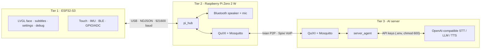

<div align="center">

# Alf — Connected AI Companion

**An embodied, voice-driven AI companion: a round-LCD face on an ESP32-S3, a Raspberry Pi Zero 2 W hub, and a remote AI server — linked over the post-quantum Ixian P2P network.**

[](https://github.com/subsubl/alf/actions/workflows/ci.yml)
[](https://github.com/subsubl/alf/actions/workflows/build-rpi-image.yml)


</div>

---

## Overview

Alf is a three-tier companion architecture. The face and sensors live on a tiny edge device; the "brain" runs remotely; nothing in between ever sees an API key.

| Tier | Hardware / Host | Code | Role |
|------|-----------------|------|------|
| **1 — Face & sensors** | Waveshare ESP32-S3-Touch-LCD-1.28-B (Zephyr RTOS + LVGL) | [`esp32_face_os/`](esp32_face_os) | Animated face, live subtitles, touch, IMU gestures, BLE radar, agent-controlled GPIO |
| **2 — Hub** | Raspberry Pi Zero 2 W + Bluetooth speaker/mic | [`pi_hub/`](pi_hub) | USB bridge to Tier 1, audio capture/playback, lip-sync pacing, QuIXI/Spixi VoIP client |
| **3 — AI server** | Any Linux host | [`server_agent/`](server_agent) | STT → LLM (with hardware tools) → TTS routing; the **only** place API keys exist |
| **Shared** | — | [`common_ixian/`](common_ixian) | Python port of Spixi `AppDataMessage` / `VoIPManager` + async QuIXI REST/MQTT client |



> **Zero-trust edge:** `LLM_API_KEY`, `STT_API_KEY` and `TTS_API_KEY` live **only** in `server_agent/.env` on Tier 3. Tiers 1 and 2 hold no provider credentials, and the Pi image build bakes in no secrets or wallet passwords. The server fails closed: unless `PI_IXIAN_ADDRESS` is set it rejects calls (`ALLOW_UNAUTHENTICATED_DEV=false`).

## Features

**Tier 1 — `esp32_face_os`**
- 240×240 GC9A01 round display with a procedural vector face: 9 emotions (`IDLE`, `LISTENING`, `THINKING`, `SPEAKING`, `HAPPY`, `SAD`, `SURPRISED`, `SLEEPING`, `ALERT`), blinking, gaze, 20 Hz viseme lip-sync and rolling live subtitles.
- Fast 4-step hardware rotation (0°/90°/180°/270° via panel MADCTL) driven by the IMU, with touch coordinates rotated to match.
- Three screens (swipe or `<`/`>`): **Face** (tap = push-to-talk / barge-in), **Settings** (brightness, volume, mic mode `vad`/`ptt`/`duplex`/`wake`, rotation mode, BLE toggle, sleep timeout), **Debug** (link status, IMU, BLE, GPIO, battery, heap).
- QMI8658 IMU on a dedicated 50 Hz thread: `shake`, `tilt`, `pickup`, `double_tap`.
- BLE passive observer (32 entries, stale pruning).
- Agent-controlled GPIO on allow-listed header pins (`15, 16, 17, 18, 21, 33, 34, 35, 36, 37`) plus battery ADC on `GPIO 1`; protected pins return `-EACCES`, bad arguments `-EINVAL`.
- Clean NDJSON-over-USB protocol at 921600 baud with console/log output disabled so frames never interleave.

**Tier 2 — `pi_hub` (Wyoming-Satellite-grade voice pipeline)**
- Asyncio orchestrator bridging the ESP32-S3 serial link and the Spixi VoIP session.
- Four mic modes: `vad` (auto voice activity), `ptt` (tap push-to-talk), `duplex` (full-duplex voice barge-in), and `wake` (on-device wake-word gating via `openWakeWord` / custom detector with refractory cooldown and a post-TTS **follow-up conversation window** for natural multi-turn dialogue).
- WebRTC / DSP audio front-end (`AudioPreprocessor`): 80 Hz high-pass rumble filter, adaptive noise suppression (`mic_noise_suppression: 0..4`), and Automatic Gain Control (`mic_auto_gain_dbfs: 0..31`) before VAD/wake evaluation.
- Smart VAD onset debounce (`vad_trigger_level` consecutive voiced frames to reject transient clicks while preserving the 300 ms pre-roll ring buffer) + `max_turn_seconds` runaway stream cutoff.
- Instant zero-latency local earcon chimes (`awake`, `done`, `error` — built-in synthesized 16 kHz chimes or custom `.wav` files) and a Bluetooth PortAudio stream watchdog (`check_and_heal_streams`) that automatically recovers when a BT headset/speaker power-cycles.
- Executes `tool_call` / `tool_batch` hardware RPCs from the agent against Tier 1.
- **Built-in Pi Hub Web GUI (`pi_hub/pi_web_gui.py`, default `http://127.0.0.1:8082`)**:
  - **QuIXI Account Creation & Wallet Provisioning**: Provision `/opt/quixi/ixian.cfg` (`walletPassword` with `chmod 600` & masked GET responses, `mainnet`/`testnet`, API/MQTT ports), set account nickname (`/setNick`), generate new derived Ixian wallet addresses (`/generatenewaddress`), view balances (`/mywallet`, `/gettotalbalance`), and export wallet backups (`/backupwallet`).
  - **Contacts, Friend Requests & One-Click AI Server Pairing**: List/search contacts (`/contacts`), send friend requests (`/addContact`), accept incoming requests (`/acceptContact`), remove contacts (`/removeContact`), send encrypted Spixi chat messages (`/sendChatMessage`), dial/hang up Spixi VoIP calls, or execute any custom QuIXI REST RPC (`/api/quixi/rpc`).
  - **ESP32-S3 Live Monitoring & Control Panel**: Real-time 240×240 round face mirror over WebSockets (`/api/ws`), 921600-baud ping & raw NDJSON console, QMI8658 6-axis IMU & 32-device BLE radar polling, allow-listed GPIO matrix + `Vbat` battery voltage readout, and Wyoming audio/earcon controls.

**Tier 3 — `server_agent` (with Open WebUI-Inspired Control Center & `/v1` Bridge)**
- OpenAI-compatible STT (`/v1/audio/transcriptions`), chat with six dynamic hardware tools (`/v1/chat/completions`) and tool-call-safe history trimming, and TTS (`/v1/audio/speech`).
- Returns synced `ChatStream` text, 20 Hz viseme envelopes and audio frames over Spixi VoIP.
- **Built-in Web GUI (`server_agent/web_gui.py`, default `http://127.0.0.1:8080`)**:
  - **Live 240×240 Round ESP32-S3 Face Canvas** synchronized over WebSockets (`/api/ws`) & SSE (`/api/events`) with real-time emotions, 20 Hz visemes, and subtitles.
  - **Streaming Chat + Collapsible Hardware Tool Call Inspector** + **"Speak on Companion"** toggle (synthesizes TTS and speaks replies aloud on the physical Pi + ESP32).
  - **Workspace Personas (`alf-companion`, `alf-engineer`, `alf-sentry`, or custom)** + **Interactive Hardware Workbench Drawer** (toggle allow-listed GPIOs, read `Vbat` mV, poll QMI8658 6-axis IMU, scan BLE radar, adjust brightness/volume/mic mode).
  - **OpenAI-Compatible Bridge (`GET /v1/models`, `POST /v1/chat/completions` JSON & SSE `stream: true`)**: Point any external **Open WebUI** instance at `http://<server>:8080/v1` to chat with Alf and trigger real ESP32/Pi hardware tools from Open WebUI.

## Repository layout

```text
.
├── esp32_face_os/     Zephyr 3.7 LTS + LVGL 8.4 firmware (Tier 1)
├── pi_hub/            Raspberry Pi hub (Tier 2)
├── server_agent/      AI server + .env.example (Tier 3)
├── common_ixian/      Spixi AppDataMessage/VoIP codec + QuIXI client
├── deploy/            setup scripts, ixian.cfg templates, systemd units, image builder
├── tools/             hardware verification and interactive test tools
├── tests/             offline unit, security and E2E suites
└── .github/workflows/ CI and Raspberry Pi image build
```

## Getting started

### 1 · Flash the ESP32-S3 face (Windows, Zephyr 3.7 LTS)

Prerequisites: Zephyr workspace at `C:\zephyrproject` (keep the path short — Windows long paths break the build), Zephyr SDK 0.16.8 with the `xtensa-espressif_esp32s3_zephyr-elf` toolchain, and `west blobs fetch hal_espressif`.

```cmd
esp32_face_os\flash.bat
```

CI builds the same firmware on every push and uploads `zephyr.bin` as an artifact.

Verify every serial stream against real hardware:

```powershell
python tools\verify_esp32_serial.py COM3 --baud 921600
python tools\pc_companion_tester.py COM3 --baud 921600   # interactive: speak, emo, imu, ble, gcfg/gset/gread, bright, dbg, ping
```

### 2 · Deploy the server (Tier 3)

```bash
deploy/setup_server.sh
cp server_agent/.env.example server_agent/.env && chmod 600 server_agent/.env
# set LLM/STT/TTS keys and PI_IXIAN_ADDRESS; keep ALLOW_UNAUTHENTICATED_DEV=false
sudo systemctl enable --now quixi-server tamagci-server-agent
```

### 3 · Set up the Pi hub (Tier 2)

**Option A — prebuilt image.** Download `tamagci-pi-zero2w-*.img.xz` from the [Releases](https://github.com/subsubl/alf/releases) page (or the artifact of a [Pi image build](https://github.com/subsubl/alf/actions/workflows/build-rpi-image.yml) run), verify the `.sha256`, and write it with Raspberry Pi Imager ("Use custom") — set Wi-Fi, user and SSH in the Imager's customisation dialog. The image is Raspberry Pi OS Lite (arm64) with Mosquitto, BlueZ/PipeWire, a self-contained linux-arm64 QuIXI build and the hub pre-installed. Services are installed but **not** enabled: finish provisioning on first boot (the MOTD lists the steps) — set the QuIXI wallet password and `server_ixian_address`, then `sudo systemctl enable --now quixi-pi tamagci-pi-hub`.

**Option B — existing Raspberry Pi OS:**

```bash
deploy/setup_pi.sh
```

Both paths end with QuIXI contact pairing (`/addContact`, `/acceptContact`) between Pi and server — see **[`deploy/DEPLOYMENT.md`](deploy/DEPLOYMENT.md)** for the full zero-trust walkthrough.

### QuIXI configuration

Templates live in [`deploy/ixian.cfg.pi.template`](deploy/ixian.cfg.pi.template) and [`deploy/ixian.cfg.server.template`](deploy/ixian.cfg.server.template):

```ini
apiPort = 8001
mqDriver = mqtt
mqHost = 127.0.0.1
mqPort = 1883
```

## Continuous integration

| Workflow | Trigger | What it does |
|----------|---------|--------------|
| [`ci.yml`](.github/workflows/ci.yml) | push, PR, reusable | Offline test suites on Python 3.11 & 3.12, ShellCheck on deploy scripts, Zephyr firmware build with `zephyr.bin` artifact |
| [`build-rpi-image.yml`](.github/workflows/build-rpi-image.yml) | `v*` tag, manual | Re-runs CI, builds QuIXI for linux-arm64 (.NET 10), assembles the Pi Zero 2 W image in a qemu chroot, publishes `.img.xz` + SHA-256 (as a release on tags) |

Cut an image release with `git tag v0.1.0 && git push origin v0.1.0`, or run **Build Raspberry Pi image** manually from the Actions tab.

## Testing

All tests run offline — no ESP32 hardware, Raspberry Pi, live QuIXI node or API keys needed (mocked ESP32, QuIXI REST/MQTT and OpenAI endpoints):

```bash
pip install -r pi_hub/requirements.txt -r server_agent/requirements.txt pytest
python tools/test_ixian_voip.py -v
python -m pytest tests tools/test_ixian_voip.py -v
```

Hardware-in-the-loop checks (`tools/verify_esp32_serial.py`) need a connected board and are intentionally not part of CI.

## Protocol notes

- **Serial (Tier 1 ↔ 2):** newline-delimited JSON, 921600 baud 8N1. Commands include `state`, `sync`, `mouth`, `dbg`, `cfg`, `gpio_cfg`, `gpio_set`, `gpio_get`, `ble_get`, `imu_get`, `ping`; the device replies with `res` and emits `evt` (touch, IMU gestures, config changes, heartbeat).
- **Ixian (Tier 2 ↔ 3):** Spixi `AppDataMessage` framing and the `VoIPManager` call lifecycle over QuIXI's REST API (`:8001`) and MQTT (`:1883`), based on [`Spixi/VoIP/VoIPManager.cs`](https://github.com/ixian-platform/Spixi/blob/master/Spixi/VoIP/VoIPManager.cs).

## Status

Tier 1 is verified on hardware; Tiers 2–3 are covered by offline tests. Live Pi ↔ server QuIXI testing and the first published Pi image are the next milestones.

## License

No license has been chosen yet. Until one is added, all rights are reserved by the author.
