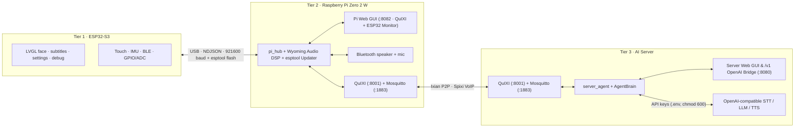

<div align="center">

# Alf — Connected AI Companion

**An embodied, voice-driven AI companion: a round-LCD face on an ESP32-S3, a Raspberry Pi Zero 2 W hub, and a remote AI server — linked over the post-quantum Ixian P2P network.**

[](https://github.com/subsubl/alf/actions/workflows/ci.yml)
[](https://github.com/subsubl/alf/actions/workflows/build-rpi-image.yml)


</div>

---

## Overview

Alf is a three-tier companion architecture. The face and sensors live on a tiny edge device; the Raspberry Pi Zero 2 W handles Wyoming-Satellite-grade voice processing, QuIXI P2P transport, and USB hardware bridging; and the "brain" runs remotely — nothing on the edge ever sees an API key.

| Tier | Hardware / Host | Code | Role |
|------|-----------------|------|------|
| **1 — Face & sensors** | Waveshare ESP32-S3-Touch-LCD-1.28-B (Zephyr RTOS + LVGL) | [`esp32_face_os/`](esp32_face_os) | Animated round face, live subtitles, touch, 50 Hz IMU gestures, BLE radar, allow-listed GPIO + `Vbat` ADC |
| **2 — Hub & Pi GUI** | Raspberry Pi Zero 2 W + Bluetooth speaker/mic | [`pi_hub/`](pi_hub) | 921600-baud USB bridge + live ESP32 firmware flasher, Wyoming DSP/VAD/wake/earcons, Spixi VoIP client, **Pi Web GUI (`:8082`)** |
| **3 — AI Server & GUI** | Any Linux host | [`server_agent/`](server_agent) | STT → LLM (with 6 hardware tools) → TTS routing, **Open WebUI-style Control Center (`:8080`)** + **`/v1` OpenAI Bridge**; the **only** place API keys exist |
| **Shared** | — | [`common_ixian/`](common_ixian) | Python port of Spixi `AppDataMessage` / `VoIPManager` + async QuIXI REST/MQTT client |



> **Zero-trust edge:** `LLM_API_KEY`, `STT_API_KEY` and `TTS_API_KEY` live **only** in `server_agent/.env` on Tier 3 (and are always masked as `sk-***...` in GUI responses). Tiers 1 and 2 hold no provider credentials, and the Pi image build bakes in no secrets or wallet passwords. The server fails closed: unless `PI_IXIAN_ADDRESS` is set it rejects calls (`ALLOW_UNAUTHENTICATED_DEV=false`).

---

## Features

### Tier 1 — `esp32_face_os` (Zephyr 3.7 LTS + LVGL 8.4)
- 240×240 GC9A01 round display with a procedural vector face: 9 emotions (`IDLE`, `LISTENING`, `THINKING`, `SPEAKING`, `HAPPY`, `SAD`, `SURPRISED`, `SLEEPING`, `ALERT`), blinking, gaze, 20 Hz viseme lip-sync and rolling live subtitles.
- Fast 4-step hardware rotation (0°/90°/180°/270° via panel MADCTL) driven by the IMU, with touch coordinates rotated to match.
- Four screens (swipe or `<`/`>`): **Face** (tap = push-to-talk / barge-in), **Settings** (brightness, volume, mic mode `vad`/`ptt`/`duplex`/`wake`, rotation mode, BLE toggle, sleep timeout), **Debug** (link status, IMU, BLE, GPIO, battery, heap), and **Network** (Raspberry Pi DHCP IPv4 address, Pi Web GUI URL, and full QuIXI Ixian cryptographic wallet address with one-tap `Refresh Info`).
- QMI8658 IMU on a dedicated 50 Hz thread: `shake`, `tilt`, `pickup`, `double_tap`.
- BLE passive observer (32 entries, stale pruning).
- Agent-controlled GPIO on allow-listed header pins (`15, 16, 17, 18, 21, 33, 34, 35, 36, 37`) plus battery ADC on `GPIO 1`; protected pins return `-EACCES`, bad arguments `-EINVAL`.
- Clean NDJSON-over-USB protocol at 921600 baud with console/log output disabled so frames never interleave.

### Tier 2 — `pi_hub` (Wyoming-Satellite Voice Pipeline + Pi Web GUI + Live ESP32 Flasher)
- Asyncio orchestrator bridging the ESP32-S3 serial link and the Spixi VoIP session.
- **Four mic modes**: `vad` (auto voice activity), `ptt` (tap push-to-talk), `duplex` (full-duplex voice barge-in), and `wake` (on-device wake-word gating via `openWakeWord` / custom detector with refractory cooldown and a post-TTS **follow-up conversation window** for natural multi-turn dialogue).
- **WebRTC / DSP audio front-end (`AudioPreprocessor`)**: 80 Hz high-pass rumble filter, adaptive noise suppression (`mic_noise_suppression: 0..4`), and Automatic Gain Control (`mic_auto_gain_dbfs: 0..31`) before VAD/wake evaluation.
- **Smart VAD onset debounce** (`vad_trigger_level` consecutive voiced frames to reject transient clicks while preserving the 300 ms pre-roll ring buffer) + `max_turn_seconds` runaway stream cutoff.
- **Instant local earcon chimes** (`awake`, `done`, `error` — built-in synthesized 16 kHz chimes or custom `.wav` files) and a **Bluetooth PortAudio stream watchdog** (`check_and_heal_streams`) that automatically recovers when a BT headset/speaker power-cycles.
- **Safe Live ESP32-S3 USB Firmware Updater (`pi_hub/esp_firmware_updater.py`)**: Validates Espressif `0xE9` magic byte + SHA-256, temporarily pauses `EspSerialBridge` to unlock `/dev/ttyACM0`, flashes `zephyr.bin` via `esptool`, resumes the 921600-baud bridge, and verifies post-flash boot via `ping`.
- **Raspberry Pi Zero 2 W optimizations** (512 MB RAM, 4× Cortex-A53): NumPy-vectorized DSP (closed-form 80 Hz high-pass, NS, AGC) instead of per-sample Python loops, throttled ESP32 lip-sync traffic, cached wallet/contacts housekeeping (`performance:` in `pi_hub/config.yaml`), systemd memory/CPU limits and single-threaded BLAS for `tamagci-pi-hub`, a memory-lean .NET GC profile for QuIXI, and [`deploy/tune_pi_zero2w.sh`](deploy/tune_pi_zero2w.sh) (zram swap, sysctls, volatile journald, Wi-Fi power-save off, unused services disabled, `gpu_mem=16`) run automatically by `setup_pi.sh`.
- **Built-in Pi Hub Web GUI (`pi_hub/pi_web_gui.py`, default `http://127.0.0.1:8082`)**: Complete browser control center for QuIXI account creation, contacts/friend requests, VoIP calls, ESP32-S3 live sensor monitoring, and one-click firmware reflashing.

### Tier 3 — `server_agent` (AI Brain + Open WebUI-Inspired Control Center & `/v1` Bridge)
- OpenAI-compatible STT (`/v1/audio/transcriptions`), chat with six dynamic hardware tools (`/v1/chat/completions`) and tool-call-safe history trimming, and TTS (`/v1/audio/speech`).
- Returns synced `ChatStream` text, 20 Hz viseme envelopes and audio frames over Spixi VoIP.
- **Built-in Server Web GUI (`server_agent/web_gui.py`, default `http://127.0.0.1:8080`)**: Dark-mode dashboard with live 240×240 virtual ESP32 face, streaming chat with collapsible tool-call inspector cards, **"Speak on Companion"** toggle, switchable **Workspace Personas**, and a remote **Hardware Workbench Drawer**.
- **OpenAI-Compatible `/v1` Bridge (`GET /v1/models`, `POST /v1/chat/completions`)**: Connect any external **Open WebUI** instance directly to `http://<server>:8080/v1` (supports both JSON and streaming SSE `stream: true`) to chat with Alf and execute live hardware tools on the ESP32-S3 + Raspberry Pi.

---

## Web Control Centers & Open WebUI Bridge

Both the Raspberry Pi Hub (Tier 2) and the Remote AI Server (Tier 3) include zero-dependency async HTTP + WebSocket (`/api/ws`) + SSE (`/api/events`) control centers.

### 1 · Raspberry Pi Hub Web GUI (`http://127.0.0.1:8082`)
Configured under `web_ui:` in [`pi_hub/config.yaml`](pi_hub/config.yaml) (`enabled: true`, `host: 127.0.0.1`, `port: 8082`, optional `auth_token`):
- **QuIXI Account Creation & Node Provisioning (`/api/quixi/account/*`)**:
  - Set `walletPassword`, `networkType` (`mainnet` / `testnet`), `apiPort` (`8001`), and `mqPort` (`1883`) in `/opt/quixi/ixian.cfg` with enforced `chmod 600` (passwords masked in all `GET` responses).
  - Set/get account nickname (`/setNick`, `/getNick`), generate new derived Ixian wallet addresses (`/generatenewaddress`), inspect wallet balances (`/mywallet`, `/viewwallet`, `/gettotalbalance`), and export encrypted wallet backups (`/backupwallet`).
- **Contacts, Spixi Friends, Direct Voice Calls & AI Server Pairing (`/api/quixi/contacts/*`, `/api/quixi/friends`, `/api/quixi/pair_server`)**:
  - List/search contacts (`/contacts`), **Add Friend** (`/addContact` with optional nickname), **Accept Friend** (`/acceptContact`), **Remove Contact** (`/removeContact`), or use **Pair as AI Server & Dial** to bind `server_ixian_address`, mutually pair, and initiate the Spixi VoIP call in one click.
  - **Direct Spixi Friend Voice Calls & ESP32 Message Display**: Add any Spixi contact as a trusted friend on the Pi (`trusted_contacts` in `pi_hub/config.yaml` or via the Pi Web GUI). You can say *"Call Alice"* (or *"Message Alice..."*) and the LLM will resolve Alice's nickname on the Pi and dial her Spixi contact (`update_companion_settings(spixi_action="call", contact_name="Alice")`). Likewise, when a trusted Spixi friend calls the Pi, `pi_hub` preempts the idle AI Server session, auto-accepts the friend's `spixi.voip` call (`auto_accept_friend_calls: true`), routes two-way audio between the friend and the Pi's Bluetooth speaker/mic, animates the ESP32-S3 mouth from the friend's voice amplitude, and shows `"Call: <Friend>"` on the round LCD. Incoming encrypted Spixi `Chat` messages from friends are automatically displayed on the ESP32-S3 LCD (`"<Friend>: <message>"`) while preserving Zero-Trust hardware RPC isolation (only `server_ixian_address` can execute `tool_call` hardware RPCs).
  - Send encrypted Spixi chat messages (`/api/quixi/chat`), dial/hang up VoIP calls (`/api/quixi/voip`), or run any raw QuIXI REST method via the **Universal QuIXI RPC Explorer** (`/api/quixi/rpc`).
- **ESP32-S3 Live Monitoring, Sensors & Firmware Updater (`/api/esp32/*`)**:
  - Live 240×240 round face canvas, 921600-baud ping & raw NDJSON console, QMI8658 6-axis IMU & 32-device BLE radar polling, allow-listed GPIO matrix (`15, 16, 17, 18, 21, 33..37`) + `Vbat` battery voltage readout, Wyoming audio/earcon controls, and browser upload + live USB reflashing of `zephyr.bin`.
- **Raspberry Pi Network & `raspi-config` Settings (`/api/system/network`, `/api/system/raspi-config`, `/api/system/power`)**:
  - Available both during **first-boot AP mode** (optional/skippable) and **anytime later** in the Pi Web GUI (`:8082`): Wi-Fi scan/connect, DHCP vs Static IPv4 (CIDR, gateway, DNS), hostname, Wi-Fi country, timezone, locale, keyboard layout, boot behaviour/wait-for-network, GPU memory split, rootfs expand, hardware interfaces (SSH, VNC, SPI, I2C, Serial HW/Console, 1-Wire, Remote GPIO), and Reboot/Shutdown.

### 2 · Remote AI Server Web GUI & `/v1` OpenAI Bridge (`http://127.0.0.1:8080`)
Configured via `WEB_UI_ENABLED=true`, `WEB_UI_HOST=127.0.0.1`, `WEB_UI_PORT=8080`, and optional `WEB_UI_TOKEN` in [`server_agent/.env.example`](server_agent/.env.example):
- **Live Companion Mirror & Chat (`/`, `/api/chat`, `/api/ws`)**: Real-time 240×240 face canvas synchronized with 20 Hz visemes, streaming chat with collapsible `<details>` hardware tool cards, and a **"Speak on Companion"** toggle.
- **Workspace Personas (`/api/personas`)**: Switch between **`alf-companion`** (Playful Desk Companion), **`alf-engineer`** (Hardware Lab Assistant), **`alf-sentry`** (BLE & Motion Sentry), or create custom personas with custom system prompts and TTS voices.
- **Remote Hardware Workbench (`/api/hardware/tool`, `/api/hardware/firmware`)**: Remotely toggle GPIOs, read `Vbat`, poll IMU, scan BLE, adjust brightness/volume/mic mode, or check/reset/reflash the ESP32-S3 LCD over Ixian P2P.
- **External Open WebUI Integration (`/v1/models`, `/v1/chat/completions`)**:
  - In **Open WebUI**, go to **Settings → Connections → OpenAI API** and add `http://<server-host>:8080/v1` (with `WEB_UI_TOKEN` as the API key if set).
  - Select `alf-companion`, `alf-engineer`, or `alf-sentry` from the Open WebUI model dropdown to chat with Alf with full hardware tool-calling and streaming SSE responses.

---

## Reflashing or Updating the ESP32-S3 LCD Firmware

Every prebuilt Raspberry Pi Zero 2 W image automatically includes `esptool`, the compiled `zephyr.bin` (at `/opt/tamagci/firmware/zephyr.bin` with `zephyr.bin.sha256`), and [`esp32_face_os/flash_pi.sh`](esp32_face_os/flash_pi.sh). You can update or reflash the ESP32-S3 LCD in four ways:

1. **Ask the LLM (Voice or Chat)**:
   - The LLM's `update_companion_settings` tool supports `firmware_action: "check" | "reset" | "flash"`, `firmware_source` (`"latest"`, file path, or HTTPS `.bin` URL), and `firmware_sha256`.
   - Ask Alf: *"Check your ESP32 firmware version and reflash the latest display firmware."*
2. **From the Pi Web GUI (`:8082`) or Server Web GUI (`:8080`)**:
   - In the **ESP32-S3 LCD Firmware Updater** card, optionally upload a new `zephyr.bin` (`Stage .bin`), then click **Reflash ESP32-S3 LCD** (or **Hardware Reset ESP32**).
   - `EspFirmwareUpdater` verifies the `0xE9` Espressif magic byte and SHA-256, temporarily pauses `EspSerialBridge` to unlock `/dev/ttyACM0`, runs `esptool`, re-opens `/dev/ttyACM0` at 921600 baud, and verifies boot with a `ping`.
3. **From the Raspberry Pi CLI (`flash_pi.sh`)**:
   ```bash
   bash /opt/tamagci/esp32_face_os/flash_pi.sh /opt/tamagci/firmware/zephyr.bin /dev/ttyACM0
   ```
   (Automatically coordinates with the running `tamagci-pi-hub` service so `/dev/ttyACM0` is cleanly released and restored.)
4. **From a Windows Development Host (Zephyr 3.7 LTS)**:
   ```cmd
   esp32_face_os\flash.bat
   ```

---

## Repository Layout

```text
.
├── esp32_face_os/                Zephyr 3.7 LTS + LVGL 8.4 firmware (Tier 1)
│   ├── src/                      Face UI, 921600-baud NDJSON protocol, 50Hz IMU, BLE, GPIO/ADC
│   ├── flash.bat                 Windows one-click Zephyr build & flash script
│   └── flash_pi.sh               Raspberry Pi / Linux coordinated USB flash script
├── pi_hub/                       Raspberry Pi Zero 2 W hub (Tier 2)
│   ├── main_hub.py               Asyncio hub orchestrator
│   ├── audio_sync_engine.py      Wyoming-Satellite DSP (NS/AGC), VAD, wake word, earcons, watchdog
│   ├── esp_serial_bridge.py      921600-baud NDJSON serial bridge with hot flash hand-off
│   ├── esp_firmware_updater.py   Safe live ESP32-S3 esptool updater & DTR/RTS hardware reset
│   ├── pi_web_gui.py             Pi Web GUI (:8082 · QuIXI account/contacts + ESP32 monitor)
│   └── config.yaml               Tier 2 configuration
├── server_agent/                 Remote AI server (Tier 3)
│   ├── main_server.py            QuIXI P2P + Spixi VoIP + turn orchestrator
│   ├── agent_router.py           AgentBrain LLM loop + 6 dynamic hardware tools
│   ├── speech_processor.py       OpenAI-compatible STT, TTS & 20Hz viseme envelope generator
│   ├── web_gui.py                Open WebUI-style Server Control Center & /v1 OpenAI Bridge (:8080)
│   └── .env.example              Zero-trust server-only API key template (chmod 600)
├── common_ixian/                 Spixi AppDataMessage/VoIP codec + QuIXI REST/MQTT client
├── deploy/                       setup_pi.sh, setup_server.sh, ixian.cfg templates, systemd, image builder
├── tools/                        Hardware verification & interactive serial/VoIP test tools
├── tests/                        126 offline unit, security, Web GUI, and E2E tests
└── .github/workflows/            CI (tests, ShellCheck, Zephyr build) & Raspberry Pi image builder
```

---

## Getting Started

### 1 · Verify or Flash the ESP32-S3 Face
Verify every serial stream against real hardware at 921600 baud:

```powershell
python tools\verify_esp32_serial.py COM3 --baud 921600
python tools\pc_companion_tester.py COM3 --baud 921600   # interactive: speak, emo, imu, ble, gcfg/gset/gread, bright, dbg, ping
```

### 2 · Deploy the AI Server (Tier 3)

```bash
deploy/setup_server.sh
cp server_agent/.env.example server_agent/.env && chmod 600 server_agent/.env
# set LLM/STT/TTS keys and PI_IXIAN_ADDRESS; keep ALLOW_UNAUTHENTICATED_DEV=false
sudo systemctl enable --now quixi-server tamagci-server-agent
```
Open `http://127.0.0.1:8080` (or tunnel via SSH) to access the **Server Control Center** or point an external **Open WebUI** instance at `http://127.0.0.1:8080/v1`.

### 3 · Set Up the Raspberry Pi Zero 2 W Hub (Tier 2)

**Option A — Prebuilt Bootable Image:**
Download `tamagci-pi-zero2w-*.img.xz` from [Releases](https://github.com/subsubl/alf/releases) (or the artifact of a [Pi image build](https://github.com/subsubl/alf/actions/workflows/build-rpi-image.yml) run), verify `.sha256`, and flash it with Raspberry Pi Imager ("Use custom"). The image is Raspberry Pi OS Lite (arm64) with Mosquitto, BlueZ/PipeWire, a self-contained `linux-arm64` QuIXI binary, `esptool`, the compiled ESP32-S3 `zephyr.bin` (`/opt/tamagci/firmware/zephyr.bin`), and `pi_hub` pre-installed.

On **first boot**, the Pi automatically starts a temporary Wi-Fi hotspot **`Alf-Setup`** (`http://192.168.4.1`) via `tamagci-firstboot.service`:
- **Required**: Create your Linux user account (`username` + `password`) and select/enter your Wi-Fi network.
- **Optional (Skippable)**: Hostname, QuIXI `walletPassword`, and `server_ixian_address` can all be skipped and configured later in the Pi Web GUI (`:8082`).

**Option B — Existing Raspberry Pi OS:**

```bash
deploy/setup_pi.sh
```

After first boot, you can complete QuIXI account creation (`walletPassword`), contact pairing (`/addContact`, `/acceptContact`), and ESP32-S3 monitoring either directly in the **Pi Hub Web GUI (`http://127.0.0.1:8082`)** or via CLI — see **[`deploy/DEPLOYMENT.md`](deploy/DEPLOYMENT.md)** for the complete walkthrough.

---

## Continuous Integration

| Workflow | Trigger | What it does |
|----------|---------|--------------|
| [`ci.yml`](.github/workflows/ci.yml) | push, PR, reusable | 126 offline tests (63 subtests) across Python 3.11 & 3.12, ShellCheck on all shell scripts, Zephyr v3.7.0 LTS firmware build uploading `zephyr.bin` |
| [`build-rpi-image.yml`](.github/workflows/build-rpi-image.yml) | `v*` tag, manual | Re-runs CI, builds QuIXI for `linux-arm64` (.NET 10), bundles `zephyr.bin` + `flash_pi.sh` + `pi_hub` into a Raspberry Pi OS Lite arm64 image in a QEMU chroot, publishes `.img.xz` + SHA-256 to GitHub Releases |

---

## Testing

All 126 tests (and 63 subtests) run 100% offline — no ESP32 hardware, Raspberry Pi, live QuIXI node, or API keys needed:

```bash
pip install -r pi_hub/requirements.txt -r server_agent/requirements.txt pytest
python tools/test_ixian_voip.py -v
python -m pytest tests tools/test_ixian_voip.py -v
```

---

## License

No license has been chosen yet. Until one is added, all rights are reserved by the author.
